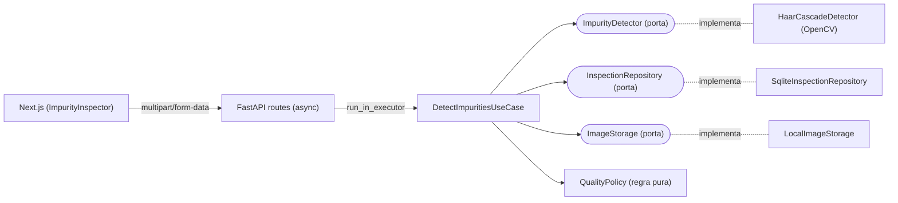

# Haar Impurity Inspector

Detecção de impurezas em metais raros com **classificadores Haar Cascade** (OpenCV),
API **FastAPI** em Clean Architecture, persistência **SQLite** e interface **Next.js**.

## Executar (um comando)

```bash
# 1. Coloque o modelo treinado em backend/models/cascade.xml
# 2. Suba tudo:
docker compose up --build
```

| Serviço  | URL                                   |
|----------|---------------------------------------|
| Frontend | http://localhost:3000                 |
| API docs | http://localhost:8000/docs (Swagger)  |
| Health   | http://localhost:8000/api/v1/health   |

> Sem `cascade.xml` a API sobe normalmente, o histórico continua acessível e
> `POST /inspections` responde **503** com uma mensagem explicando o motivo.
> Para um *smoke test* do pipeline sem modelo próprio, aponte `CASCADE_PATH` para
> um cascade embutido no OpenCV, por exemplo
> `/usr/local/lib/python3.12/site-packages/cv2/data/haarcascade_frontalface_default.xml`.

## Arquitetura



A regra de dependência aponta sempre para dentro: `api → application → domain`;
`infrastructure` implementa as portas do `domain`. Só o *composition root*
(`app/core/container.py`) conhece as classes concretas.

```
backend/app/
├── domain/            # Entidades, portas (Protocols), regras puras, exceções
├── application/       # Casos de uso (orquestração, sem tecnologia)
├── infrastructure/    # OpenCV, SQLAlchemy/SQLite, filesystem
├── api/               # FastAPI: rotas, schemas Pydantic
├── core/              # Configuração + composition root
└── main.py            # App, lifespan, CORS, /media, mapeamento de erros
```

### Concorrência
* Handlers `async`: o upload é lido em chunks no event loop (com limite de tamanho).
* Decodificação da matriz, Haar Cascade, escrita em disco e SQLite rodam em um
  `ThreadPoolExecutor` **dedicado e limitado** (`INFERENCE_WORKERS`), via
  `loop.run_in_executor` — o servidor nunca bloqueia.
* OpenCV libera o GIL → paralelismo real entre threads.
* `cv2.CascadeClassifier` não é thread-safe → uma instância por thread (`threading.local`).
* SQLite em modo WAL: leituras do histórico não bloqueiam a gravação.

### Classificação de qualidade (`QualityPolicy`)
Baseada na **fração da área contaminada** (união exata das caixas, sem dupla contagem) e na contagem:

| Qualidade | Área contaminada | Nº impurezas |
|-----------|------------------|--------------|
| PREMIUM   | ≤ 0,5 %          | ≤ 2          |
| STANDARD  | ≤ 2 %            | ≤ 10         |
| LOW       | ≤ 5 %            | —            |
| REJECTED  | > 5 %            | —            |

## API

| Método | Rota                          | Descrição                         |
|--------|-------------------------------|-----------------------------------|
| GET    | `/api/v1/health`              | Status + modelo carregado         |
| POST   | `/api/v1/inspections`         | Upload (`file`) e detecção        |
| GET    | `/api/v1/inspections`         | Histórico paginado                |
| GET    | `/api/v1/inspections/{id}`    | Detalhe com bounding boxes        |
| GET    | `/media/{id}/original.*`      | Imagem original                   |
| GET    | `/media/{id}/annotated.jpg`   | Imagem anotada pelo OpenCV        |

## Treinamento do modelo

```
backend/training/data/
├── annotations.csv   # filename,x,y,width,height (1 linha por impureza)
├── positives/        # imagens com impurezas
└── negatives/        # imagens de metal limpo
```

```bash
cd backend
python training/prepare_dataset.py            # Pandas: valida, gera positives.dat/bg.txt e estatísticas
bash training/train_cascade.sh 800 1600 24 24 15
python training/evaluate.py --csv training/data/test_annotations.csv --images training/data/test
```

> `opencv_createsamples`/`opencv_traincascade` não fazem parte do `opencv-python` 4.x;
> use os binários do OpenCV 3.4.x.

`evaluate.py` usa o **mesmo** `HaarCascadeDetector` da API e reporta Precision/Recall/F1 por IoU.

## Testes

```bash
cd backend
pip install -r requirements-dev.txt
pytest -q
```

## Desenvolvimento sem Docker

```bash
# backend
cd backend && pip install -r requirements.txt && uvicorn app.main:app --reload
# frontend
cd frontend && npm install && npm run dev
```
